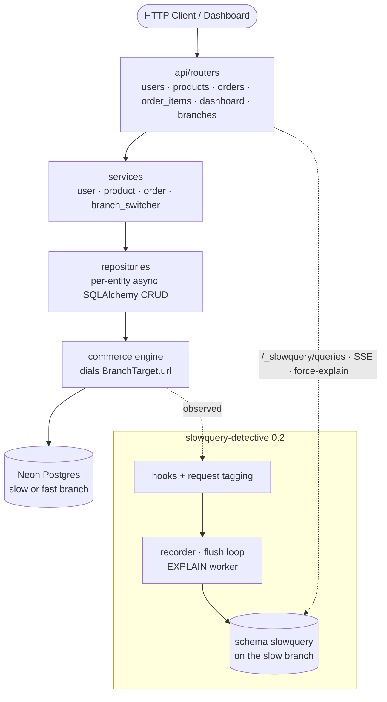
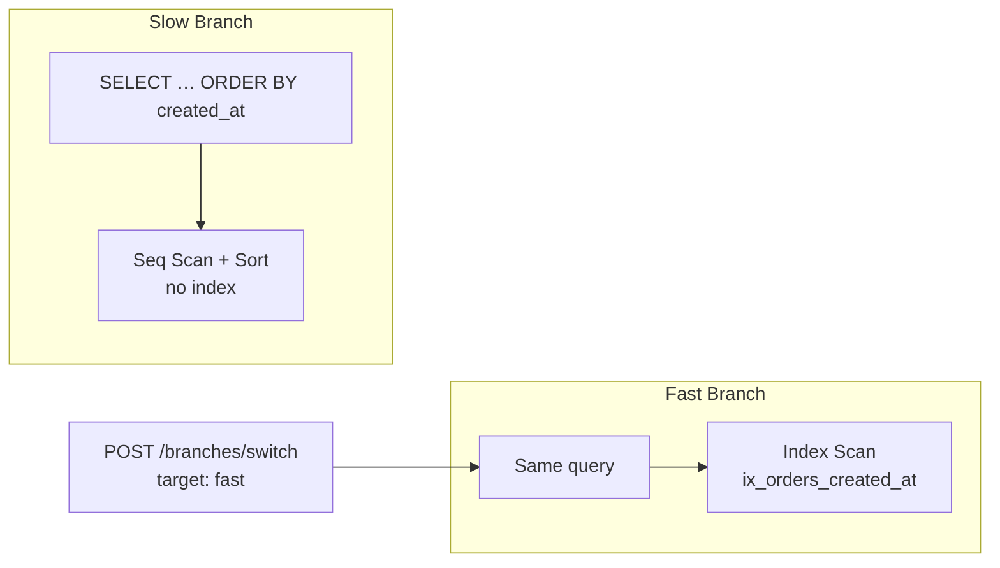

# 🔬 `slowquery-demo-backend`

> ⚡ **FastAPI demo service for the slowquery-detective observability pipeline.**
> Seeded commerce dataset, two Neon branches (slow vs fast), real EXPLAIN plans, and a live SSE stream — all on a public URL.

🌐 [Live API](https://slowquery-demo-backend.onrender.com) · 📖 [OpenAPI](https://slowquery-demo-backend.onrender.com/docs) · 📦 [slowquery-detective](https://pypi.org/project/slowquery-detective/) · 🖥️ [Dashboard](https://github.com/Abdul-Muizz1310/slowquery-dashboard-frontend) · 📐 [Specs](docs/specs/)


-6e9f18?style=flat-square)

[](https://github.com/Abdul-Muizz1310/slowquery-demo-backend/actions/workflows/ci.yml)


---

The two read routes are [slowquery-detective 0.2](https://pypi.org/project/slowquery-detective/)'s own ([spec 15](docs/specs/15-slowquery-detective-0-2.md)). The shape of one row of `GET /_slowquery/queries` (illustrative values; the live numbers move with traffic):

```console
$ curl -s -H "X-Platform-Token: $TOKEN" https://slowquery-demo-backend.onrender.com/_slowquery/queries \
    | jq '.[0]'
{
  "id": "7f9c44d378fe11e2",
  "fingerprint": "select orders.id, orders.user_id, orders.status, orders.total_cents, orders.created_at from orders where orders.user_id = cast(? as uuid) order by orders.created_at desc, orders.id desc limit cast(? as int)",
  "first_seen": "2026-10-20T20:18:10.850418Z",
  "last_seen": "2026-10-20T21:57:01.532134Z",
  "call_count": 211,
  "total_ms": 34301.4,
  "p50_ms": 8.57,
  "p95_ms": 10.68,
  "p99_ms": 20.73,
  "max_ms": 110.07,
  "suggestions": [
    {
      "kind": "index",
      "source": "rules",
      "sql": "CREATE INDEX IF NOT EXISTS ix_orders_created_at ON orders(created_at);",
      "rationale": "Sort node on ORDER BY created_at with significant cost; an index ending with created_at would let the planner skip the sort step.",
      "applied_at": null
    }
  ]
}
```

`fingerprint` is the canonical SQL; `id` is the 16-char hash. `GET /_slowquery/queries?request_id=R` lists only the fingerprints request `R` (its `X-Request-Id`) ran, with that request's counts and `null` percentiles: that is what bastion's dossier measures. `/_slowquery/*` needs a platform token (spec 14); without one it answers only while the service runs with `DEMO_MODE=true`. The dashboard reaches it through its signing proxy, and the commerce routes stay public.

Drive traffic into it:

```console
$ uv run python -m scripts.traffic_generator \
    --host https://slowquery-demo-backend.onrender.com --duration 60 --users 3 --json
{"total": 36, "failures": 0, "p95_ms": 14062.000000005355, "exit_code": 0}
```

Those are real numbers from a real 60-second run against the live URL on 2026-08-02; `p95_ms` is wall-clock from a laptop over the Render → Neon round-trip, and the process exits non-zero if p95 crosses 30 s or the failure rate crosses 20 % (that tripwire is the point — see [DEMO.md](docs/DEMO.md)).

---

## 🎯 Why this exists

Phase 4b of the [slowquery-detective](https://pypi.org/project/slowquery-detective/) portfolio project. The PyPI middleware captures slow queries, but it needs a **live target** — a real service with real slow queries running on a public URL.

This backend is that target: a seeded commerce database with intentionally missing indexes, wired to the middleware, producing real fingerprints, EXPLAIN plans, and rule-engine suggestions that the [dashboard frontend](https://github.com/Abdul-Muizz1310/slowquery-dashboard-frontend) visualizes.

The demo's punchline: switch from the `slowquery` branch (no indexes, seq scans) to `slowquery-fast` (indexed) and the seq-scan / sort queries become index scans. The size of the p95 drop is **seed-dependent** — the full 1M-order seed produces a large, dramatic delta; the documented 100k-order seed shows a smaller one (see [DEVIATIONS §1 / §4](docs/DEVIATIONS.md)). Measure it yourself with [`benchmarks/bench_demo_latency.py`](benchmarks/bench_demo_latency.py) rather than trusting a number in a README.

---

## ✨ Features

- 🛒 Seeded commerce dataset — users, products, orders, order_items (100k+ rows)
- 🔀 Two Neon branches: `slowquery` (no indexes, seq scans) and `slowquery-fast` (4 indexes)
- 🔍 slowquery-detective 0.2 installed through its public API (`install(..., service="slowquery", authorize=...)`): request tagging, a Postgres store in schema `slowquery`, real-parameter EXPLAIN
- 📊 Dashboard API at `/_slowquery/*` — fingerprints, samples, plans, suggestions
- 📡 SSE stream for live p95 updates to the frontend
- 🔀 Branch switch endpoint — swap slow ↔ fast in one POST, plus a read-only `/branches/current`
- 🙈 Never observes itself: the library's store and the `/health` probe run on engines the hooks are not attached to
- 🚦 Traffic generator, run against the live URL every 6 h by a GitHub Actions schedule (`.github/workflows/traffic.yml`)
- 🧪 269 unit + 53 integration tests (Testcontainers, both lanes in CI), 96% unit-lane line coverage
- 🗃️ Migrations apply themselves: the container migrates the slow branch, the fast branch and the store before it serves
- 🛡️ Pydantic v2 schemas, `Literal` types, frozen DTOs
- 🚀 Render free tier — Render's GitHub integration auto-deploys `main` on push (no CI deploy hook)

---

## 🏗️ System architecture



### 🔁 One observed engine, repointed on a switch

slowquery-detective binds its hooks and EXPLAIN worker to the engine passed to `install` for the app's lifetime, so `POST /branches/switch` never replaces it: it health-checks the target branch, points the engine's connection target at it and disposes the pools. Queries, hooks and EXPLAIN all follow the switch; the library's rolling percentiles restart ([spec 15](docs/specs/15-slowquery-detective-0-2.md)).

### 🔀 Two-branch demo flow



> The exact cost / latency numbers depend on seed size and the Neon compute tier, so they are not asserted here. Run [`benchmarks/bench_demo_latency.py`](benchmarks/bench_demo_latency.py) against your own seeded branches to get real figures.

---

## 🗂️ Project structure

```
src/slowquery_demo/
├── main.py                        # FastAPI app factory, middleware, lifespan
├── api/
│   └── routers/
│       ├── users.py               # /users, /users/{id}/orders
│       ├── products.py            # /products
│       ├── orders.py              # /orders (fires sort_without_index rule)
│       ├── order_items.py         # /order_items
│       ├── dashboard.py           # /_slowquery/api/stream (SSE) + force-explain (the read routes are the library's)
│       └── branches.py            # /branches/switch, /branches/current
├── services/
│   ├── user_service.py            # user query logic
│   ├── product_service.py         # product query logic
│   ├── order_service.py           # order / order-item query logic
│   └── branch_switcher.py         # branch-swap business logic
├── repositories/                  # per-entity async SQLAlchemy CRUD (sole SQLAlchemy importers)
│   ├── user_repository.py
│   ├── product_repository.py
│   ├── order_repository.py
│   └── order_item_repository.py
├── models/                        # SQLAlchemy 2.0 async models
│   ├── base.py                    # DeclarativeBase
│   ├── user.py · product.py · order.py · order_item.py
│   └── slowquery_store.py         # 0.1-era bookkeeping tables: kept by 0001/0002, no longer written
├── schemas/                       # Pydantic v2 DTOs (frozen, Literal-typed)
│   └── user.py · product.py · order.py · pagination.py · branches.py
└── core/
    ├── config.py                  # pydantic-settings from .env
    ├── database.py                # BranchTarget + the commerce and health engines that dial it
    ├── db_config.py               # asyncpg URL normalisation
    ├── branch_state.py            # .branch_state load/save (survives restarts)
    ├── access.py                  # mutation cooldown + admin-token gates
    ├── platform.py                # CORS, /health, /version, /metrics, / → /docs
    ├── platform_auth.py           # contract-v2 middleware (public / 401 / 503 / principal)
    ├── platform_token.py          # pure token verification (claims, leeway, key decides iss)
    ├── platform_keys.py           # bastion + dashboard public keys (env, cached URL fetch)
    ├── public_routes.py           # which method + path need no token
    ├── errors.py                  # typed DomainError → HTTP mapping
    └── observability.py           # slowquery-detective install: service id, store URL, LLM, authorize

alembic/versions/0001_initial.py   # full 8-table schema (commerce + bookkeeping)
alembic/versions/0002_dedupe_suggestions.py  # dedupe suggestions + ensure their unique constraint
docker-entrypoint.sh               # migrate every database, then exec uvicorn
scripts/                           # seed_slow · seed_fast · traffic_generator · smoke_health · migrate_all
```

---

## 🌐 API surface

Every route except the public ones needs a platform token (contract v2, [spec 14](docs/specs/14-platform-contract-v2.md)): an Ed25519 JWT in `X-Platform-Token` (or `Authorization: Bearer`) with `aud "slowquery"`, signed by bastion's key (`iss "bastion"`) or the dashboard's own key (`iss "slowquery-frontend"`, `role "frontend"`). Without one a protected route answers `401 missing_platform_token`, unless `DEMO_MODE=true` (default `false`) lets the request through anonymous; an invalid token is always `401 invalid_platform_token`; with no trusted key configured protected routes answer `503 platform_auth_unconfigured`.

| Method | Endpoint | Auth | Purpose |
|---|---|---|---|
| `GET` | `/health` | public | Liveness + service identity |
| `GET` | `/version` | public | Build version |
| `GET` | `/users?limit=N`, `/users/{id}` | public | Seeded users |
| `GET` | `/users/{id}/orders` | public | Seq scan on `orders.user_id` (slow branch) |
| `GET` | `/orders?limit=N`, `/orders/{id}` | public | `ORDER BY created_at` — fires `sort_without_index` rule |
| `GET` | `/products?limit=N`, `/products/{id}` | public | Seeded products |
| `GET` | `/order_items?product_id=…` | public | Seq scan on `order_items.product_id` |
| `GET` | `/_slowquery/queries` | token | Dashboard API — live fingerprint list with suggestions |
| `GET` | `/_slowquery/queries/{id}` | token | Full detail for one fingerprint (plan, samples, suggestions) |
| `POST` | `/_slowquery/queries/{id}/force-explain` | token + `X-Admin-Token` | 🔒 Re-analyze (fails closed unless `DEMO_MUTATION_TOKEN` is set) |
| `GET` | `/_slowquery/api/stream` | token | 📡 SSE — live p95 updates per fingerprint |
| `POST` | `/branches/switch` | token | Switch between `slow` and `fast` Neon branch (cooldown per visitor) |
| `GET` | `/branches/current` | token | Active branch — read-only, not throttled |
| `GET` | `/docs`, `/redoc`, `/openapi.json`, `/metrics` | public | OpenAPI UI (`/` redirects here), Prometheus |

> 🔒 The two state-mutating endpoints (`force-explain`, `branches/switch`) are hardened for the public URL on top of the token: a cooldown (`DEMO_MUTATION_COOLDOWN_S`) bucketed per visitor (`bastion:{sub}` for a bastion token, the dashboard proxy's forwarded visitor address for a dashboard token, the leftmost `X-Forwarded-For` address when anonymous), and the destructive `force-explain` fails closed unless `DEMO_MUTATION_TOKEN` is set. See [DEVIATIONS](docs/DEVIATIONS.md).

---

## 🛠️ Stack

| Concern | Choice |
|---|---|
| **Language** | Python 3.12 (uv for everything, no pip) |
| **Framework** | FastAPI + SQLAlchemy 2.0 async + asyncpg |
| **Middleware** | [`slowquery-detective`](https://pypi.org/project/slowquery-detective/) `>=0.2,<0.3`, public API only |
| **Database** | Neon serverless Postgres, two branches (`slowquery` / `slowquery-fast`) |
| **Migrations** | Alembic async env, two revisions (`0001_initial.py` full schema, `0002_dedupe_suggestions.py`), applied to every branch by the container entrypoint at boot ([spec 13](docs/specs/13-migrations-on-deploy.md)) |
| **Tests** | pytest + pytest-asyncio, 269 unit + 53 integration (Testcontainers), 96% unit-lane coverage |
| **Lint / Types** | ruff + mypy `--strict` on `src/` |
| **Hosting** | Render Free tier — Render's own GitHub integration deploys `main` on push |
| **CI** | GitHub Actions: lint → test (+ per-module coverage floors) and integration (Testcontainers) → build (boots the image against two Postgres services and checks both are migrated) → smoke (post-deploy `/health`, skipped unless `SMOKE_BASE_URL` is set); a separate `traffic` workflow drives the live URL every 6 h |

---

## 🚀 Run locally

```bash
# 1. clone & env
git clone https://github.com/Abdul-Muizz1310/slowquery-demo-backend.git
cd slowquery-demo-backend
uv sync --all-extras
cp .env.example .env
# fill in Neon + OpenRouter secrets

# 2. migrate & seed
DATABASE_URL=postgresql://.../neondb?sslmode=require \
  uv run alembic upgrade head
DATABASE_URL=postgresql://.../neondb?sslmode=require \
  uv run python -m scripts.seed_slow --reset \
    --users 1000 --products 200 --orders 100000 --order-items 500000

# 3. serve
uv run uvicorn slowquery_demo.main:app --reload
# → http://localhost:8000/health
# → http://localhost:8000/_slowquery/queries
```

### 🚦 Traffic generator

```bash
# Against the local server started above (the default --host):
uv run python -m scripts.traffic_generator --duration 60 --users 3 --json
# {"total": 36, "failures": 0, "p95_ms": 14062.000000005355, "exit_code": 0}
#   ^ shape of the output; the numbers above are from a real run against the
#     live Render URL, so a local run against a fast Postgres will differ.
```

Flags: `--host` (default `http://localhost:8000`), `--duration` (seconds, default 60), `--users` (default 20, sets the inter-request pacing), `--json` (print the summary line). The run populates fingerprints, samples, plans and suggestions, and exits non-zero if p95 > 30 000 ms or the failure rate > 20 %. [`.github/workflows/traffic.yml`](.github/workflows/traffic.yml) runs it against the live URL every six hours (and on `workflow_dispatch`) after polling `/health` until the free-tier instance is awake, so a broken demo shows up as a red run of that workflow ([spec 07](docs/specs/07-traffic-generator.md)).

---

## 🧪 Testing

```bash
uv run pytest -m "not slow and not integration"   # unit lane (CI `test` job)
uv run pytest -m integration --no-cov             # Testcontainers lane (CI `integration` job; needs Docker)
uv run pytest -m slow --no-cov                    # the one subprocess-spawning slow test
uv run pytest --cov=src/slowquery_demo --cov-report=term-missing
```

| Metric | Value |
|---|---|
| **Unit tests** | 269 (unit lane, `-m "not slow and not integration"`) |
| **Integration tests** | 53 (Testcontainers; CI `integration` job) |
| **Line coverage** | **96%** (unit lane, `--cov-fail-under=80`) |
| **Methodology** | Red-first spec-TDD. Specs `00`–`10` and `12`–`15` in `docs/specs/` enumerate their test cases before the code ships. **Spec `11` (mutation gating) is the one exception**: the code landed first in response to an audit and the spec was reconstructed from it afterwards — [it says so at the top](docs/specs/11-mutation-gating.md). |

> **Honesty note:** every test now lives in a numbered `test_NN_*.py` file, each case carrying the `docs/specs/` case it verifies. Assertions are on behaviour, not on source text — the three surviving file-content greps are the documented [no-index guards](docs/ARCHITECTURE.md), and the traffic generator's endpoint-scope tests (one of which was satisfied by a dead constant planted in the script) now drive its real request loop under `respx`. The earlier standalone `*_coverage.py` files — an after-the-fact, line-targeting coverage pass that asserted mock-call counts and reached into private attributes — have been removed. The two largest (`test_full_coverage.py` + `test_final_coverage.py`, ~1.7k lines) and the six smaller ones (`{dashboard,pagination,repositories,router,services,store_writer}_coverage.py`, ~0.7k lines) were deleted; their behaviourally meaningful cases (`clamp_limit`/cursor round-trips, the fingerprint-id validator, repository/service DTO mapping) were folded into the matching numbered spec files, and the pure line-padding cases were dropped. The suite is now spec-first end to end.

---

## 📐 Engineering philosophy

| Principle | How it shows up |
|---|---|
| 🧪 **Spec-TDD** | Every feature slice has a spec in `docs/specs/` with enumerated test cases before code ships. |
| 🛡️ **Negative-space programming** | Typed domain errors (`UserNotFoundError`, `ConfigError`), `Literal` types for branch targets, frozen Pydantic DTOs. |
| 🏗️ **MVC layering** | `routers → services → repositories → models`. Controllers never touch SQLAlchemy; repos are the only layer that imports it. |
| 🔤 **Typed everything** | `mypy --strict` clean. Pydantic v2 DTOs, typed SQLAlchemy models, no `Any`. |
| 🌊 **Pure core, imperative shell** | Business logic stays unit-testable; DB/HTTP side effects live at the edges. |
| 🎯 **One responsibility per module** | Every file describes exactly one thing — never "and". |

---

## 🚀 Deploy

Render free tier via [`render.yaml`](render.yaml). Render's GitHub integration watches `main`, so **pushing is the deploy** — CI does not fire a deploy hook and there is no `RENDER_DEPLOY_HOOK` secret ([DEVIATIONS §11](docs/DEVIATIONS.md)).

1. Render dashboard → **New → Blueprint** → connect this repo
2. Fill env vars in service settings (`DATABASE_URL`, `DATABASE_URL_FAST`, `SLOWQUERY_STORE_URL`; `BASTION_SIGNING_KEY_PUBLIC` (or `BASTION_PUBLIC_KEY_URL`) and `SLOWQUERY_FRONTEND_SIGNING_KEY_PUBLIC`, without which protected routes answer 503; optionally `DEMO_MUTATION_TOKEN` to enable `force-explain`)
3. Push to `main` → Render rebuilds; CI runs lint → test / integration → build in parallel. On boot, [`docker-entrypoint.sh`](docker-entrypoint.sh) runs `alembic upgrade head` against each of those databases before uvicorn starts (Render's free plan ignores `preDeployCommand`, so there is none); a failed migration stops the boot and the previous deploy keeps serving
4. *Optional:* set a `SMOKE_BASE_URL` repository variable to the service URL and CI's `smoke` job will poll the deployed `/health` after the build. Leave it unset and the job skips (spec 12) — nothing to break.

---

## 📄 License

MIT. See [LICENSE](LICENSE).

---

> 🔬 **`slowquery-demo --help`** · seeded queries, real EXPLAIN plans, two branches
