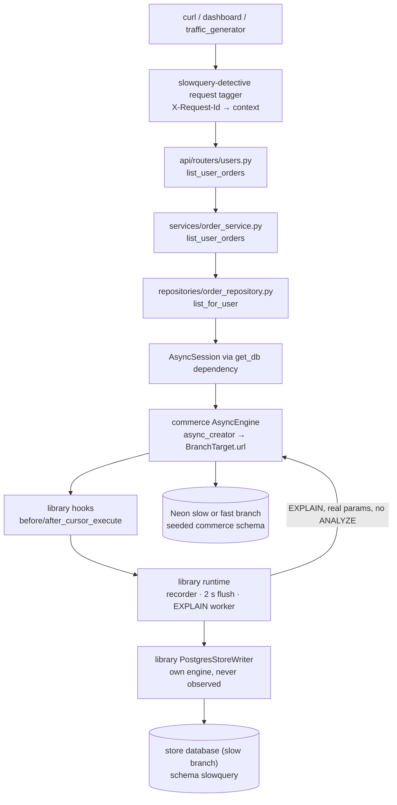
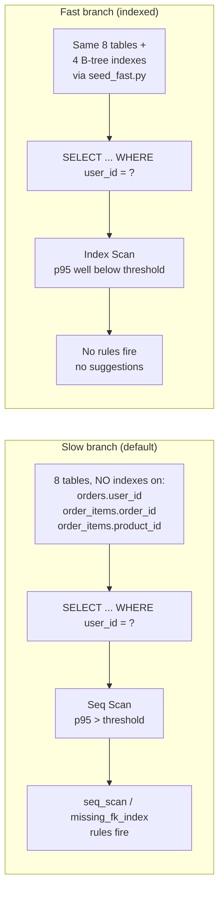
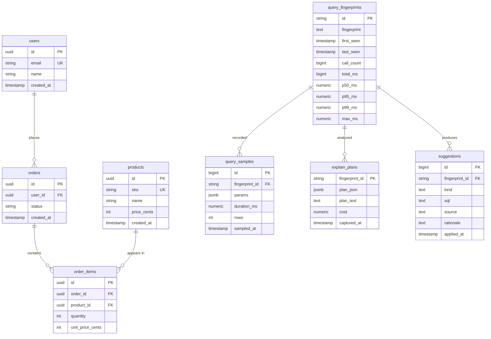
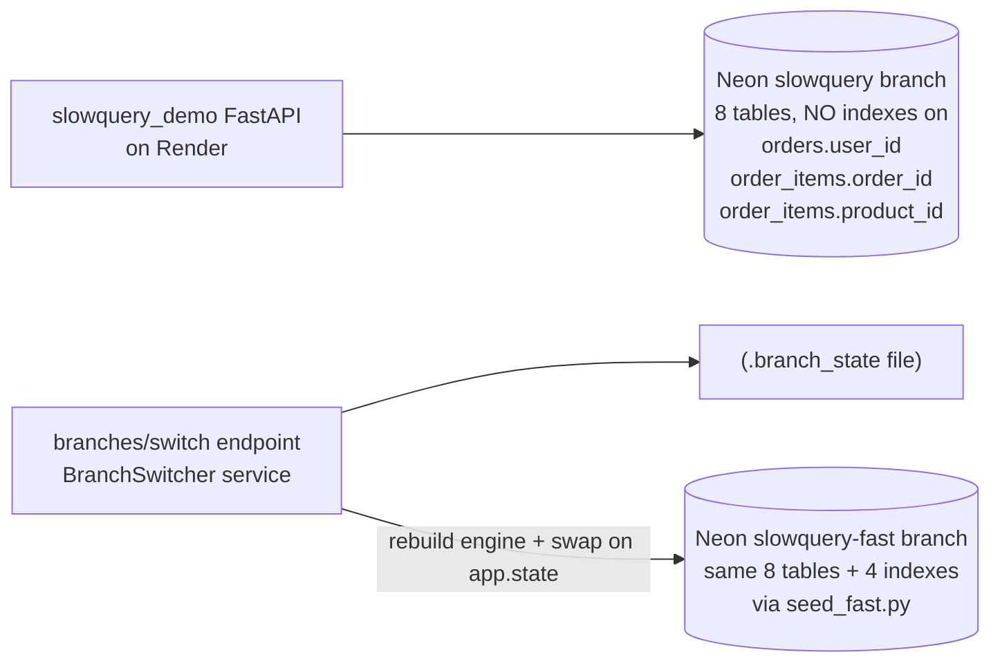

# Architecture

## Strict MVC layering

```
api/routers     →   HTTP surface (FastAPI; thin; no SQLAlchemy imports)
services/       →   business logic (pure; raises typed DomainError subclasses)
repositories/   →   async SQLAlchemy select()/text() — the ONLY layer that imports SQLAlchemy
models/         →   SQLAlchemy 2.0 DeclarativeBase ORM classes
schemas/        →   Pydantic v2 DTOs + PaginatedResponse[T]
core/           →   config (Settings), database (BranchTarget + the commerce
                     and health engines), db_config (asyncpg URL
                     normalisation), branch_state (.branch_state persistence),
                     access (mutation cooldown + admin-token gates), errors
                     (DomainError + exception handlers), observability
                     (slowquery-detective 0.2 install + authorize hook),
                     platform (health, version, metrics, CORS), platform_auth /
                     platform_token / platform_keys / public_routes (contract v2)
```

Controllers never touch the DB. Models never know about HTTP. Pure core, imperative shell.

## Data plane (the route `/users/{id}/orders` takes)



Everything right of the hooks is slowquery-detective 0.2 ([spec 15](specs/15-slowquery-detective-0-2.md)); the demo
calls only `install(...)`. The hooks are attached to the commerce engine only: the library's store and the
`/health` probe use their own engines, so the observability pipeline never observes itself.

## Two-branch demo

The demo showcases the library's value by contrasting a branch with no indexes (slow) against a branch with indexes (fast). This makes the seq scan / missing index rules fire reliably.



## Database schema

All 8 tables live on each Neon branch, created by the hand-written Alembic migration `0001_initial.py`; `0002_dedupe_suggestions.py` guarantees the suggestions unique constraint on branches migrated before `0001` was (wrongly) edited.



The first four tables are the commerce domain (seeded with fake data). The last four are the 0.1-era bookkeeping tables in schema `public` ([`models/slowquery_store.py`](../src/slowquery_demo/models/slowquery_store.py)): migrations `0001`/`0002` still own them, but since spec 15 nothing writes them. slowquery-detective 0.2 keeps its data in its own schema `slowquery` (`query_fingerprints`, `request_stats`, `query_samples`, `explain_plans`, `suggestions`, `schema_version`), created at startup on the store database.

### Deliberate source-text guard tests

Three unit tests assert on *file contents* rather than behaviour. They are the exception, not the pattern, and each guards a negative that has no runtime surface to observe (the absence of DDL cannot be asserted from an API response):

| Test | Guards |
|---|---|
| [`test_00_schema.py::test_migration_does_not_create_forbidden_indexes`](../tests/unit/test_00_schema.py) | the Alembic migration never adds an index on `orders.user_id`, `order_items.order_id` or `order_items.product_id` — the demo's slow branch depends on their absence |
| [`test_02_seed_slow.py::test_script_body_has_no_create_index_statement`](../tests/unit/test_02_seed_slow.py) | `seed_slow.py` never issues `CREATE INDEX` |
| [`test_03_seed_fast.py::test_create_index_appears_only_in_fast_indexes_constant`](../tests/unit/test_03_seed_fast.py) | every `CREATE INDEX` in `seed_fast.py` is a reviewed entry of the `FAST_INDEXES` tuple — no stray index escapes PR review |

Everything else asserts behaviour. The traffic generator's endpoint-scope tests used to grep its source too (and one of them was satisfied by a dead `_GREP_MARKER_HEADLESS` constant planted for that purpose); they now drive the real request loop under `respx` — see [DEVIATIONS §10](DEVIATIONS.md).

## Two Neon branches



The branch-switch code path repoints the one commerce engine at runtime (spec 15): it health-checks the target URL with `SELECT 1`, sets `BranchTarget.url`, disposes the commerce and health pools and clears the library's rolling percentiles. The engine object never changes, so slowquery-detective's hooks and EXPLAIN worker follow the switch (DEVIATIONS §3, closed).

## Key endpoints

| Surface | Purpose | Slow-path trigger |
|---|---|---|
| `/health` | Liveness probe (platform middleware) | -- |
| `/version` | Build identity | -- |
| `/_slowquery/queries` | Dashboard API -- returns the fingerprint list | -- |
| `/_slowquery/queries/{id}` | One fingerprint: plan, samples, suggestions | -- |
| `/_slowquery/queries/{id}/force-explain` | Re-analyze (admin-token gated, fail-closed) | -- |
| `/_slowquery/api/stream` | SSE -- live p95 ticks + heartbeats | -- |
| `/users`, `/products` | Fast reads (unique indexes on email / sku) | -- |
| `/orders?limit=N` | Recent orders, `ORDER BY created_at DESC` | **sort_without_index** rule |
| `/users/{id}/orders` | Orders for one user | Seq Scan on `orders.user_id` |
| `/orders/{id}` | Order + its items (join to `order_items`) | Seq Scan on `order_items.order_id` |
| `/order_items?product_id=...` | Items for one product | Seq Scan on `order_items.product_id` |
| `/branches/switch` | Swap the active branch: rebuilds + swaps the `AsyncEngine`, clears the buffer, re-attaches the hooks (cooldown-throttled) | -- |
| `/branches/current` | Read the active branch (read-only, ungated) | -- |

The `/branches/switch` row used to read "full engine rebuild deferred", and later "EXPLAIN pool does not follow". Both are closed: the switch repoints the engine the library observes and explains on.

The observability pipeline never observes its own reads: the library's store runs on its own engine and `/health`'s `SELECT 1` on the uninstrumented health engine, so neither can climb to the top of `/_slowquery/queries` and bury the commerce slow queries the demo exists to show.

## The four library compatibility shims (retired)

0.1.0 needed four monkey-patches here (lifespan wiring, an injectable store, execution-context timing, a
sync-hook-to-async bridge with real-parameter EXPLAIN). slowquery-detective 0.2.0 upstreamed all four and
the demo now uses its public API only (DEVIATIONS §8, closed; [spec 15](specs/15-slowquery-detective-0-2.md)).

## Migration path

Alembic async env reads `DATABASE_URL` via `slowquery_demo.core.db_config.get_database_url()` which runs the URL through `normalise_asyncpg_url()` so libpq-style `sslmode` / `channel_binding` params don't break asyncpg.

Two migrations: [`alembic/versions/0001_initial.py`](../alembic/versions/0001_initial.py) -- hand-written DDL for all 8 tables + the `order_status` enum -- and [`0002_dedupe_suggestions.py`](../alembic/versions/0002_dedupe_suggestions.py), which deletes duplicate suggestions and adds `uq_suggestions_fp_kind_sql` where it is missing ([spec 13](specs/13-migrations-on-deploy.md)). `0001` is pinned by hash: an applied migration is never edited. The no-index guard test ([`tests/unit/test_00_schema.py::test_migration_does_not_create_forbidden_indexes`](../tests/unit/test_00_schema.py)) greps every revision and fails the build if any change adds an index on the three demo-critical columns.

Render's free plan [ignores `preDeployCommand`](RENDER_FREE_TIER_MIGRATIONS.md), so the container migrates itself: [`docker-entrypoint.sh`](../docker-entrypoint.sh) runs [`scripts/migrate_all.py`](../scripts/migrate_all.py), which applies `alembic upgrade head` to `DATABASE_URL`, `DATABASE_URL_FAST` and (if it names another database) `SLOWQUERY_STORE_URL` before uvicorn starts. A failed migration stops the boot.
